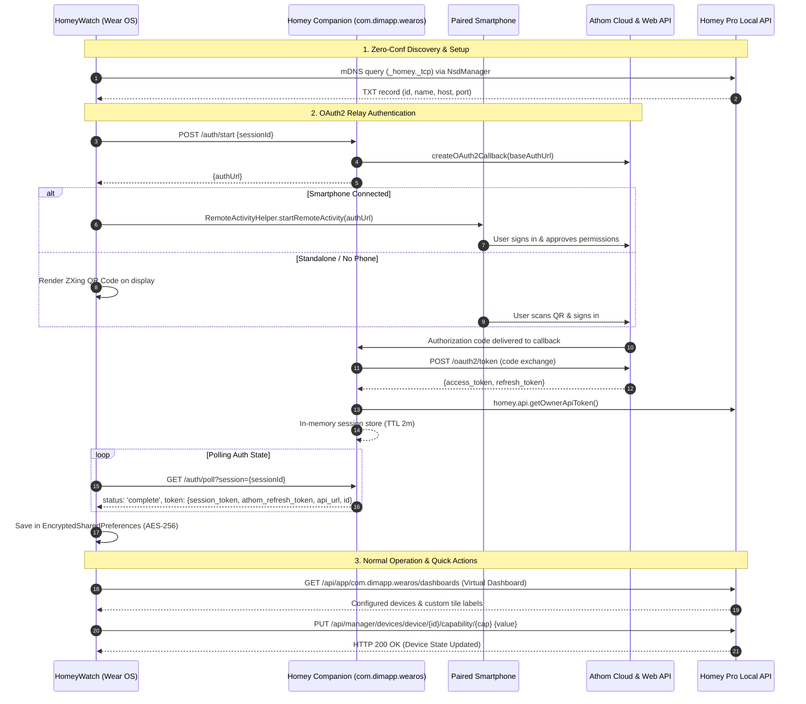

# Homey for Wear OS (HomeyWatch) ⌚🏡

[-4285F4.svg?logo=wearos&logoColor=white)](https://developer.android.com/wear)
[](https://kotlinlang.org)
[](https://developer.android.com/jetpack/compose)
[](https://developer.android.com/training/wearables/tiles)
[](LICENSE)
[](https://github.com/s-dimaio/com.dimapp.wearos)

A modern, production-grade, standalone **Wear OS 3+** smart home control client for **Athom Homey Pro** (2023 and 2026 models).

---

## 🌟 Overview

**Homey for Wear OS** brings the full power of your Athom Homey Pro smart home directly to your wrist. Engineered with a "standalone-first" architecture, the application communicates directly with your Homey Pro over local Wi-Fi or secure cloud channels (Athom Connect), freeing you from dependency on a connected smartphone during everyday operation.

### Key Highlights
* **True Standalone Operation**: Control your home over Wi-Fi or LTE even when your phone is turned off or in another room.
* **Glanceable Wear OS Tiles (2x2 Grid)**: Quick-access action tiles on your watch face carousel for 1-tap toggling of favorite devices, with dedicated slots for up to 4 hubs.
* **4-Tab Navigation Carousel**: Fluid horizontal carousel with custom curved bezel header (`HubCurvedHeader`) and fixed bottom dock (`MainNavigationDock`) spanning **Home** (favorites), **Devices** (room-by-room hierarchy), **Flows** (triggerable automations), and **Settings** (multi-hub management).
* **Multi-Hub Topology**: Connect and seamlessly switch between up to 4 independent Athom Homey Pro hubs (e.g., Home, Office, Vacation Home).
* **Zero-Configuration Discovery (mDNS)**: Automatically detects Homey Pro hubs on your local network via `_homey._tcp` using Android `NsdManager`.
* **Universal Capability Controls**: Dedicated, capability-driven control screens for lighting (power, dimmers, RGB color palette, white temperature presets), thermostats (0.5°C stepper), security locks, and garage doors.
* **Homey Insights (Recap)**: On-demand historical state transition telemetry loaded directly on the watch display.
* **Built-in Demo Mode**: Fully isolated in-memory mock environment for testing and Play Store review without requiring a physical Homey hub.

---

## 🏗️ Architecture & Interaction Diagram

The application interfaces directly with your Homey Pro hub via local REST endpoints, the Athom Connect cloud API, and the [Wear OS Companion App](https://github.com/s-dimaio/com.dimapp.wearos) running on the Homey hub:



---

## 📱 Navigation & User Interface

The UI is built entirely using **Jetpack Compose for Wear OS** with a true-black AMOLED theme for optimal battery life and circular screen ergonomics:

| Screen | Description |
| :--- | :--- |
| **Home (`HomeScreen`)** | Dedicated strictly to your priority favorite devices (`quickDevices`) from the Virtual Dashboard. |
| **Devices (`MainDashboardScreen`)** | Comprehensive room-by-room hierarchy of all connected devices with temperature badges. |
| **Flows (`FlowsScreen`)** | Categorized list of triggerable Athom Homey automation Flows organized by folder. |
| **Settings (`SettingsScreen`)** | Multi-hub switcher (up to 4 hubs), sync interval selector, and instant disconnection. |
| **Detail (`DeviceDetailScreen`)** | Multi-tab capability controller: On/Off toggle, RGB color picker, white temperature presets, thermostat steppers, and Insights history. |

---

## 🔒 Security & Privacy

* **Hardware-Backed Encryption**: All OAuth2 tokens, API secrets, and hub mappings are stored in `EncryptedSharedPreferences` backed by **AES-256-GCM** (values) and **AES-256-SIV** (keys) via the **Android Keystore**.
* **Zero Telemetry**: No third-party analytics SDKs, no advertising frameworks, and no external tracking servers.
* **Direct Communication**: Network calls are strictly routed to either your local Homey Pro hub on Wi-Fi or the official encrypted Athom Connect APIs (`https://*.connect.athom.com`).
* **Instant Erasure**: Tapping **"Disconnect"** in Settings immediately purges all credentials, tokens, and cached metadata from hardware storage.

---

## 🛠️ Tech Stack & Dependencies

* **Language**: [Kotlin 2.2](https://kotlinlang.org/) with Coroutines 1.7 & Guava.
* **UI**: [Jetpack Compose for Wear OS](https://developer.android.com/jetpack/compose) (Material 1.4 & Foundation), [Horologist 0.6](https://google.github.io/horologist/).
* **Tiles**: AndroidX Wear Tiles & [ProtoLayout 1.4](https://developer.android.com/training/wearables/tiles).
* **Networking**: [Retrofit 2.9](https://square.github.io/retrofit/) & [OkHttp 4.12](https://square.github.io/okhttp/) with custom Auth & Token Rotation interceptors.
* **Serialization**: [Gson 2.10](https://github.com/google/gson).
* **Image Loading**: [Coil 2.6](https://coil-kt.github.io/coil/) with SVG decoder and authenticated OkHttp pipeline.
* **Discovery & Auth**: Android `NsdManager` (mDNS DNS-SD), [ZXing 3.5](https://github.com/zxing/zxing) (QR Code generation), and `RemoteActivityHelper`.
* **Security**: [AndroidX Security Crypto 1.1](https://developer.android.com/jetpack/androidx/releases/security).

---

## 🚀 Building & Development

### Prerequisites
* **Android Studio** Ladybug (2024.2+) or newer.
* **Android SDK** API 36 (`compileSdk = 36`, `targetSdk = 36`, `minSdk = 30`).
* **Java Development Kit** (JDK) 17.
* A physical **Wear OS 3+** smartwatch or Wear OS Emulator (API 30+).

### Building the Project
1. Clone the repository:
   ```bash
   git clone https://github.com/s-dimaio/HomeyWatch.git
   cd HomeyWatch
   ```
2. Open the project in **Android Studio**.
3. Sync Project with Gradle Files.
4. Select your target Wear OS device or emulator and run the `app` configuration.

---

## 🧪 Demo Mode (Testing Without a Physical Hub)

For rapid developer testing and Google Play Store review without a physical Homey Pro hub:
1. Launch the app on your watch or emulator.
2. On the setup screen, tap **"Enter ID manually"**.
3. Type `demo` in the input field.
4. Tap **"Connect Hub"**.
5. The app unlocks full access to simulated devices (lights, thermostat, lock, garage door), flows, and tiles without network calls.

---

## 📄 Privacy Policy & License

* **Privacy Policy**: Read the full policy in [`PRIVACY_POLICY.md`](PRIVACY_POLICY.md) or online at [s-dimaio.github.io/HomeyWatch/privacy.html](https://s-dimaio.github.io/HomeyWatch/privacy.html).
* **License**: Licensed under the **GNU General Public License v3.0** — see [`LICENSE`](LICENSE) for details.

---

## ⚠️ Disclaimer

Homey for Wear OS is an independent third-party application. It is NOT an official application by Athom B.V., and it is not affiliated with, endorsed, or sponsored by Athom B.V. Athom, Homey, and Homey Pro are registered trademarks of Athom B.V.
